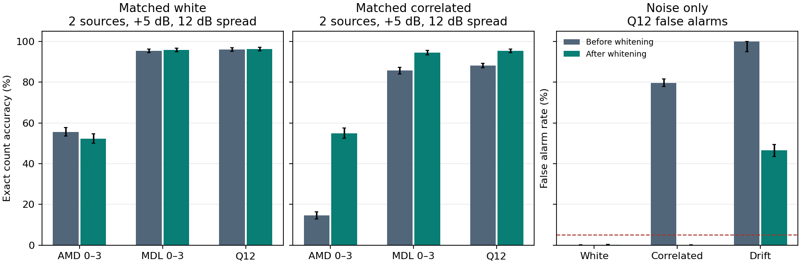

# When Noise Calibration Drifts

## A reproducible MUSIC source-counting benchmark

**How much can an array estimator trust a noise calibration after the environment changes?** This benchmark tests source counts on synthetic eight-sensor snapshots, then profiles a complete CPU MUSIC estimator and evaluates possible hardware partitions.

Independent calibration reduced the 12-bit heuristic's false alarms from **79.63% to 0.06%** with matched correlated noise. When correlation increased from 0.20 to 0.35, the same heuristic still raised **46.53%** false alarms after whitening. Whitened MDL raised **0.58%** in that case. The current Q12-to-RTL direction stops here. The hardware study treats the MDL pipeline as the reference for future work.



[Raw decisions](results/robustness/trials.csv.gz) · [Cell counts and confidence intervals](results/robustness/cells.csv) · [Performance report](docs/performance.md) · [FPGA feasibility](docs/hardware.md) · [Methodology audit](docs/audit.md)

## Run it

From a clone of this repository, use Python 3.13 and install the pinned dependencies:

```sh
python -m pip install -r requirements.txt
python -m music_benchmark
```

The second command reruns the original count experiment, the paired whitening experiment, the CPU profiler, and the fixed-point sensitivity study. It writes CSV, JSON, and plots under `reproduction/`. For only the source-count experiments, add `--robustness-only`. Statistical results are seeded. Wall-clock timing and memory depend on the host.

```sh
python -m unittest discover -s tests -v
```

The optional CUDA measurement runs separately on a compatible NVIDIA GPU with a CUDA 12 runtime and the corresponding libraries.

```sh
python -m pip install cupy-cuda12x==13.6.0 fastrlock==0.8.3
python -m music_benchmark.gpu --out reproduction/gpu
```

## The engineering question

MUSIC estimates directions using the separation between a signal subspace and a noise subspace. The source count determines that split. Too few sources can leave signal energy in the estimated noise subspace, and too many can generate spurious peaks or trigger further downstream processing on noise-only frames. The count experiment isolates that decision. The performance experiment includes the rest of the estimator.

AMD and Fidus Systems publish an [AI Engine tutorial](https://github.com/Xilinx/Vitis-Tutorials/blob/337d3c7e7fe9a4bd44821208a20c95ace0d1e774/AI_Engine_Development/AIE/Design_Tutorials/18-MUSIC-Algorithm/README.md) for an eight-element, half-wavelength ULA and 128-sample frames. Their VCK190 path uses QR followed by a fixed-sweep Jacobi SVD. Its [source-count code](https://github.com/Xilinx/Vitis-Tutorials/blob/337d3c7e7fe9a4bd44821208a20c95ace0d1e774/AI_Engine_Development/AIE/Design_Tutorials/18-MUSIC-Algorithm/aie/svd/svd.cpp#L71-L99) compares squared column norms with 5% of the first and uses all eight passing as the no-source sentinel. Our **AMD rule proxy** applies the scalar decision to the exact, sorted covariance eigenvalues. The tutorial uses its own ordering, arithmetic and scanner. Our CPU measurements describe an independent covariance/eigenvalue implementation and cannot be compared directly with the tutorial's reported hardware throughput.

## Model and estimators

With eight sensors and $N=128$ snapshots, let $x_t$ be a complex sensor column vector and $a(\theta)_m=\exp(j\pi m\sin\theta)$. The zero-mean covariance estimate is $R=\sum_t x_tx_t^H/N$. For a calibration estimate $C=LL^H$ from separate noise-only samples, compute $W=L^{-1}$, transform snapshots as $Wx_t$, and transform the steering atoms as $Wa(\theta)$. The angle pipeline normalizes transformed atoms before scoring.

For descending eigenvalues $\lambda_i$ and candidate source count $k$, MDL minimizes

$$N(8-k)\log\!\left(\frac{\operatorname{AM}(\lambda_{k+1:8})}{\operatorname{GM}(\lambda_{k+1:8})}\right)+\frac{k(16-k)}{2}\log N.$$

With $E_n$ the chosen noise eigenvectors and $\tilde a$ the unit steering atom, the normalized MUSIC denominator is $\|E_n^H\tilde a\|_2^2$. Its grid minima identify angle candidates. Both a dense projector and a direct projection are profiled. Independent SVD with scalar steering projections checks numerical consistency. See the original MUSIC and MDL papers in [References](REFERENCES.md).

| Source-count rule | Decision |
| --- | --- |
| AMD 5% proxy | Count $\lambda_i>0.05\lambda_1$ and interpret eight as zero. The restricted comparator then caps the interpreted count at three. |
| MDL | Search candidate orders 0–7 or 0–3. It assumes approximately white residual noise and a suitable covariance model. |
| Floating-point tail threshold | Compare up to the three largest eigenvalues against 2.25 times the median of the smallest four. |
| Q12 tail threshold | Normalize by $\lambda_1$, round to codes 0–4095, and use an integer comparison equivalent to the same threshold. Only the count input is quantized. |

## Count accuracy under calibration drift

The paired run covers **46,656 frames across 27 cells**. Each cell has 1,728 frames across 72 independent calibration blocks, with 2,048 noise-only samples per block. Use independent calibration and evaluation streams, the same test frames before and after whitening, and the same transform for each estimator. Test sources have independent complex Gaussian emissions, zero to three sources, at least 6° separation, and up to 12 dB power spread. Correlated noise is Toeplitz, with entry $C_{ij}=\rho^{|i-j|}$. The robustness run adds diagonal loading of 0.1% of average sensor power. Intervals resample whole calibration blocks, are pointwise, and use conservative bounds for observed endpoint rates.

| Noise-only scenario | Q12 before → after | MDL 0–3 after |
| --- | ---: | ---: |
| Matched white | 1 → 4 / 1,728 (0.23%) | 0 / 1,728 |
| Matched correlated, 0.20 | 1,376 → 1 / 1,728 (0.06%) | 0 / 1,728 |
| Correlation changes, 0.20 → 0.35 | 1,728 → 804 / 1,728 (46.53%) | 10 / 1,728 (0.58%) |

- Under drift, the Q12 false-alarm interval was **43.52–49.48%**. The MDL interval was **0.23–0.98%**. The Q12 failure is well above the 5% decision threshold.
- Q12 beat the equally whitened, capped AMD rule by **100.00** and **43.98 percentage points** in the two specified white-noise cells. Against equally whitened MDL 0–3, the average exact-count difference over source-present cells was **+0.043 points** (95% paired interval **−0.113 to +0.200**). Drift with one source at 0 dB produced an **11.81-point Q12 deficit**.
- Float and Q12 agreed on **46,627 / 46,656** whitened frames (99.94%). The lowest observed cell agreement was **1,721 / 1,728** (99.59%). They can agree on a wrong decision. The drift failure persists in the floating-point rule.

The two original pilot seeds also reproduce the earlier noise-only colored totals of **460/600** Q12 false alarms, **30/600** MDL false alarms, and **600/600** float/Q12 agreements. [First pilot seed](results/robustness/pilot-20261113.csv) · [Second pilot seed](results/robustness/pilot-20261114.csv) · [Audit and limitations](docs/audit.md)

## Performance and hardware

On the i7-10750H with one BLAS thread, the whitened projected pipeline with scalar MDL took **164.1 µs median, 305.6 µs p95, and 418.7 µs p99** per frame. A scalar implementation of the same MDL criterion reduced count-stage median time from **63.3 to 15.1 µs**. After that change, eigendecomposition was the largest single measured stage at **43.4 µs**, with spectrum generation and peak detection at **35.2 and 35.4 µs**. Covariance accumulation took **16.8 µs**. This profile points toward the decomposition and angular search before an isolated count or covariance accelerator. The profiling fixtures use matched correlated noise and a separate calibration setup with 1% trace-target shrinkage. [Measurement methodology and raw timings](docs/performance.md)

The GPU study measures whitening, covariance, and eigenvalues on an RTX 2060 with synchronized wall-clock timing. At batch 1, the CPU median was **48.6 µs** and GPU transfer-inclusive median **1,585.2 µs**. At batch 256, the same comparison was **6,338.5 µs** versus **1,354.8 µs per batch**. This is a batched subpipeline result. The GPU measurements exclude eigenvectors, angle search, batch fill time and the rest of the estimator. Resident and transfer timings came from separate blocks and should be read independently. [GPU samples and setup](results/gpu/)

The fixed-point study measures how quantizing candidate boundaries affects downstream MDL and DOA. The FPGA timing and resource models use explicit assumptions and operation counts. The study reports CPU measurements and software simulation. An FPGA build, achieved clock, power, and integrated transport latency remain to be measured. [Hardware analysis](docs/hardware.md)

## Limits and next experiment

The drift study uses simulated, stationary Toeplitz noise within each frame. Narrowband independent emitters, stable geometry, and access to noise-only calibration frames simplify the sensing problem. It cannot establish false-alarm rates for field data, fast drift, array mismatch, coherent emitters, or multiple simultaneous changes. The computational profile measures small fixed dimensions on one laptop. Scope and model provenance are documented in the [audit](docs/audit.md) and [references](REFERENCES.md).

**Decision B — continue algorithmic investigation.** Test a calibration-aware estimator under repeated drift. On the same preallocated frames, compare snapshot whitening with covariance-domain whitening, then profile a compiled CPU angle scan and peak selector against the current implementation. Check count, angle and false alarms alongside single-frame p95/p99. Set the target frame cadence and input location before evaluating an offload boundary.

For a separate accelerator project, an RTX 2060 radar pulse-compression experiment can measure the hardware tradeoff now. Compare planned cuFFT against an FFT–multiply–IFFT kernel using the same synthetic radar frames and common detection path. Sweep batch size and report both device-resident and transfer-inclusive latency. [NVIDIA radar example](https://developer.nvidia.com/blog/realizing-the-power-of-real-time-network-processing-with-nvidia-doca-gpunetio/) · [NVIDIA convolution examples](https://docs.nvidia.com/cuda/cufftdx/examples.html#convolution-examples)
