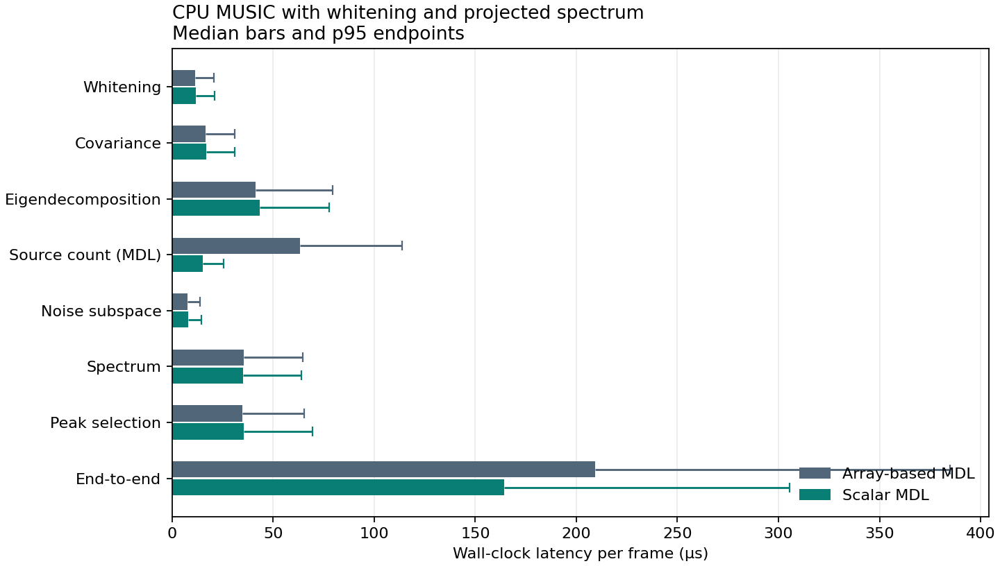

# CPU MUSIC performance

The profile runs 400 fixed synthetic frames through four combinations of raw or whitened input and dense or projected steering scans. Five source-count rules share those inputs. Each frame contains 128 time samples from an eight-element half-wavelength array. A separate 2,048-sample noise block estimates the whitening transform, with 1% trace-target shrinkage. The four fixtures cycle through zero to three sources in matched, spatially correlated noise. The statistical robustness study measures calibration drift separately.

The recorded host used an Intel Core i7-10750H, Python 3.13.3, NumPy 2.2.0 and one OpenBLAS 0.3.28 thread. Each case warmed up on 32 frames. Case order rotates within each frame. Stage timings use monotonic wall-clock checkpoints, with timing records assembled after the last checkpoint. Separate uninstrumented runs give per-frame totals and five sequential throughput repeats. Stage quantiles do not add up to the total quantiles. The measurements include Python dispatch, host allocations and scheduling variation. [Environment](../results/profile/environment.json) · [Stage samples](../results/profile/stage_samples.csv.gz) · [Stage summaries](../results/profile/stage_summary.csv) · [Throughput repeats](../results/profile/throughput.csv)

| CPU path and count rule | Median µs | p95 µs | p99 µs | Median frames/s |
| --- | ---: | ---: | ---: | ---: |
| Raw dense, AMD 5% proxy | 150.25 | 280.10 | 317.39 | 8,539 |
| Raw dense, scalar MDL | 161.90 | 292.34 | 331.82 | 5,169 |
| Whitened dense, scalar MDL | 170.45 | 306.80 | 355.45 | — |
| Whitened projected, vector MDL | 209.20 | 384.92 | 444.52 | — |
| Whitened projected, scalar MDL | 164.10 | 305.58 | 418.72 | 6,529 |
| Whitened projected, Q12 median rule | 185.15 | 344.94 | 394.01 | 4,935 |

Throughput is measured as frames divided by the elapsed time of each batch of sequential calls. There is no stream ingress, calibration, batching delay or host-to-device transfer in this CPU figure. For whitened projected scalar MDL, the five repeats ranged from 4,137 to 6,850 frames/s.

## Stage breakdown

| Whitened projected, scalar MDL | Median µs | p95 µs | p99 µs |
| --- | ---: | ---: | ---: |
| Whiten snapshots | 11.80 | 21.10 | 38.83 |
| Covariance | 16.80 | 31.00 | 35.65 |
| Eigendecomposition | 43.40 | 77.83 | 102.21 |
| Source count | 15.10 | 25.41 | 29.24 |
| Construct noise subspace | 7.80 | 14.40 | 20.63 |
| Scan spectrum | 35.20 | 63.81 | 79.22 |
| Select angles | 35.40 | 69.31 | 84.92 |

On the 300 scalar-MDL frames where scanning was active, prewhitened dense/projected median construction time was 13.2/8.1 µs and scan time was 38.7/37.7 µs. This compares identical count decisions and whitened inputs. Separate medians were 674.5 µs to estimate the covariance, make the whitener and prepare steering, 369.9 µs to synthesize an evaluation frame, and 1,471.7 µs to synthesize the calibration block. Synthetic generation is outside the processing path.

The Q12 rule needs two additions and three comparisons once supplied with eight sorted, common-scale codes. The measured Python path also normalizes, rounds and clips the eigenvalues. Its count-stage median was 38.55 µs compared with 15.10 µs for scalar MDL and 63.30 µs for vector MDL. Both MDL implementations minimize the same objective over orders 0–3. Scalar MDL shares suffix sums and fixed penalties, using 12 logarithms and three comparisons to choose among four scores. The wall-clock result favors the scalar CPU implementation over the measured Q12 path. The arithmetic counts describe separate mapping options for hardware.

These analytical counts describe the algorithm dimensions. They are neither CPU instruction counts nor cycle measurements.

| Stage | Arithmetic scale for this frame |
| --- | --- |
| Snapshot whitening | Dense 128 × 8 by 8 × 8 multiply, up to 8,192 complex products and 7,168 complex additions. A triangular implementation can exploit zeros. |
| Covariance | The full 8 × 8 product uses 8,192 complex products before scaling. A Hermitian-aware streaming design computes only eight powers and 28 cross-products per snapshot. |
| Hermitian eigendecomposition | One 8 × 8 solve per frame. Dense work scales cubically with sensor count. The LAPACK path has implementation- and input-dependent work, so no fixed multiply count is assigned. |
| Scalar MDL | Four orders, eight eigenvalue logs and four suffix-mean logs, plus running sums, penalties and three argmin comparisons. |
| Noise subspace | The projected scan selects an eigenvector view. For two sources, the dense variant also forms an 8 × 8 projector using 384 complex products. |
| MUSIC spectrum | For two sources and 240 grid bins, the projected scan uses 11,520 complex products and 1,440 magnitude squares. |
| Peak selection | The scanner checks up to 238 interior bins and orders the detected minima. The second step depends on the number of local minima. |

Relative to the 164.1 µs uninstrumented median, eigendecomposition accounts for roughly 26% and the spectrum plus peak stages for roughly 43%, using each stage's own median. The stage measurements are separate and the fractions serve as a rough prioritization guide.

## Memory and numerical agreement

For the whitened projected paths, Python/NumPy traced peaks above baseline were 79,569 bytes for scalar MDL and 79,825 bytes for Q12. These figures exclude fixture buffers, precomputed steering and native allocations that the tracer cannot observe. The Windows lifetime peak working set was 82,223,104 bytes and includes setup, other cases and benchmark output assembly. [Memory samples](../results/profile/memory.csv)

An independent reference computes a snapshot SVD, solves the whitening triangular system directly and scans with scalar complex dot products. Across 24 frames per configuration and 480 comparisons, the optimized and reference paths agreed on all counts and grid angles. The maximum absolute errors were `1.71e-13` in covariance eigenvalues and `1.63e-14` in the normalized MUSIC denominator. This comparison checks the software methods against each other. Its angle agreement does not measure error against physical ground truth. The AMD proxy and common scanner use different numerical steps from the tutorial's finite-sweep SVD and scanner. [Numerical comparisons](../results/profile/numerical.csv)

## Production comparisons

- Compare a compiled CPU path with reusable buffers and precomputed steering. The measured stage profile points to eigendecomposition, scanning and peak selection as the largest scalar-MDL stages. Covariance, subspace projection and angle picking can be profiled independently before committing to an accelerator boundary.
- With fixed whitening over a calibration interval, compute the raw frame covariance and form `R_white = W @ R_raw @ Wᴴ`. This is algebraically equivalent to whitening each time sample before forming the known-zero-mean covariance. A dense 8×8 transform processes the covariance once per frame and reuses the same normalized whitened steering. Applying a complex triangular solve to all 128 vectors instead costs 3,584 complex multiply-subtracts plus 1,024 scales. Calibration estimates 8 diagonal powers and 28 cross terms per noise sample, then factors the regularized matrix once per calibration block. Charge its cost at the actual recalibration cadence.
- The RTX 2060 test times only whitening, covariance and eigenvalues. It is a separate FP32 batch study with synchronized timings and transfer-inclusive results. Eigenvectors and the angle path would need measurement before deciding on a GPU system partition. [GPU measurements](../results/gpu/summary.csv)
